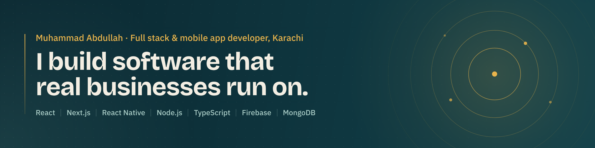

## Hi, I'm Abdullah

I'm a full stack and mobile app developer from Karachi and a third-year Computer Science student at the University of Karachi. I build web and Android apps end to end, from the database schema to the screens people use every day, and several are in daily use at a banquet hall and a coaching center in Karachi.

- **Now:** building IJK ERP v2 for IJK Coaching System, with fee vouchers, Kuickpay payment slots, notifications and a teacher app
- **Experience:** Developer Intern at NBP Funds (Oracle APEX), Full Stack Intern at DecodeLabs, Front-End Intern at DevelopersHub Corporation
- **Open to:** internships, full-time roles and freelance projects

## Featured work

| Project | What it is | Built with |
| --- | --- | --- |
| **Two Rings Banquet Management System**  Private · real client | Booking and management PWA for a banquet hall in Karachi: CEO and Manager dashboards, seasonal pricing, branded PDF receipts, Firestore transactions that prevent double bookings, and offline mode | Next.js 14, TypeScript, Firebase, Tailwind CSS |
| **Clinic Management System**  Private | Real-time token queue for reception and doctors, patient self-service portal, prescriptions tied to each visit, video appointments, and an AI assistant in the doctor's dashboard | Next.js, Firebase |
| **IJK ERP**  Private · in progress | ERP for IJK Coaching System covering fee vouchers, online fee payment slots, notifications and a teacher app | TypeScript |
| [**IJK Smart Attendance Pro**](https://github.com/connectabdullahdev/ijk-smart-attendance-pro) | GPS attendance app for the center's teachers with fake GPS detection, one account per device, leave requests and PDF/Excel reports | JavaScript, Firebase, Capacitor |
| [**Urban Store**](https://github.com/connectabdullahdev/urban-store) | E-commerce mobile app with auth, cart, wishlist, checkout, dark mode and offline persistence | React Native, Redux Toolkit, Firebase |
| [**Business Nexus**](https://github.com/connectabdullahdev/DevelopersHub-Nexus-Platform) · [demo](https://developershub-nexus-platform.vercel.app/) | Investor and entrepreneur platform; I added the meeting calendar, video call, document e-signing, payments and 2FA security modules | React, TypeScript, Tailwind CSS |
| [**DecodeLabs full stack series**](https://github.com/connectabdullahdev/Decodelabs-3rd-project) | One app in three layers: [responsive frontend](https://github.com/connectabdullahdev/Decodelabs-1st-project) → [REST API](https://github.com/connectabdullahdev/Decodelabs-2nd-project) (40/40 tests) → [MongoDB Atlas](https://github.com/connectabdullahdev/Decodelabs-3rd-project) (55/55 tests) | Node.js, Express, MongoDB, Mongoose |
| [**Aura Ethereal**](https://github.com/connectabdullahdev/weather-app) · [demo](https://connectabdullahdev.github.io/weather-app/) | Weather app in five languages with forecasts, air quality, a live map and day planning | JavaScript, Chart.js, Capacitor |

## Tech I work with

  

Also: React Native, Expo, Capacitor, Oracle Database and Oracle APEX, SQL and PL/SQL, Shopify.

## Get in touch

